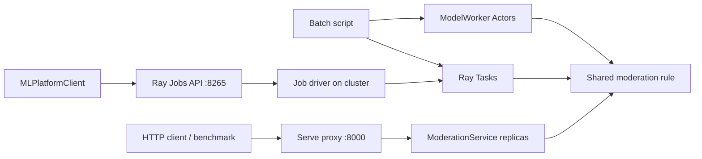

# Mini ML Platform

**Status: local learning project complete across Ray Tasks, Actors, Jobs SDK,
and Serve.** The Jobs lifecycle and Serve HTTP endpoint have been verified on a
local Ray cluster.

A small, local learning project for a software engineer exploring ML infrastructure.
Generate 1,000 synthetic chat messages, apply a deterministic toy moderation rule,
and compare sequential Python, Ray Tasks, and Ray Actors on your Mac.

**This is a concurrency demonstration, not a realistic ML inference benchmark.**
`time.sleep()` simulates latency without doing model computation. Its scaling does
not predict CPU/GPU inference performance, and the keyword rules are not suitable
for real content moderation. There are no external moderation calls.

Measured results and the reasoning behind them are collected in the
[experiment log](docs/experiment_log.md). It covers Task CPU and batch-size
experiments, the Task/Actor comparison, and Serve concurrency and replicas.

## What this project demonstrates

| Layer | Implementation | What it teaches |
| --- | --- | --- |
| Moderation | Typed messages and deterministic keyword rules | A shared contract and a sequential correctness baseline |
| Batch execution | Ray Tasks, batching, ordered result collection | Parallel scheduling, resource requests, overhead, exception propagation |
| Stateful workers | A reusable pool of Ray Actors | Model initialization, persistent state, reuse, resource lifetime |
| Job submission | A small Python SDK around Ray Jobs | Packaging code, submitting, polling, reading logs, stopping jobs |
| HTTP serving | Ray Serve with input validation and autoscaling | Request routing, replicas, concurrency, latency and throughput |
| Verification | Unit, Ray integration, and live HTTP tests | What can be mocked and what needs a real runtime |



The diagram shows different entry paths, not a requirement to run every component
at once. A Ray cluster provides processes and scheduling resources; Serve is an
application running on that cluster. Dashboard/Jobs uses port 8265, while the
moderation HTTP endpoint uses port 8000.

## Read and review

1. **[Learning guide](docs/learning_guide.md):** explanations, code pointers,
   worked examples, troubleshooting, and questions with answers.
2. **[Experiment log](docs/experiment_log.md):** actual measurements and their
   limitations. Use this when asking “what did we observe?”
3. **[Learning plan](docs/learning_plan.md):** the original progression and ten
   completed final checkpoints.
4. **[Milestone 1 journal](docs/learning_journal.md):** historical predictions,
   measurements, and a worksheet you can reuse.

The original four-milestone learning scope is complete. “Complete” refers to this
local educational project, not a production ML platform.

## Results at a glance

| Experiment | Recorded result | Lesson |
| --- | --- | --- |
| Tasks: 100 messages, 10 batches, 50 ms/message | Execution: 5.831 s with 1 CPU slot; 2.177 s with 4 | More available slots allow overlapping batches |
| Same Task experiment, 4 CPU slots | Sequential: 5.359 s; Ray startup + execution: 11.432 s | Faster execution does not guarantee a faster cold run |
| Serve: 20 requests, client concurrency 8 | Median total: 7.861 s with 1 fixed replica; 3.921 s with 2 | More service capacity helped this simulated workload |
| Serve autoscaling: 100 requests, concurrency 8 | Observed 1 → 2 → 1 replicas | Scaling decisions and replica readiness take time |

These are historical local measurements, not guarantees or results of the current
autoscaling configuration with fixed replicas. See the [full experiment log](docs/experiment_log.md)
for repeated trials, latency percentiles, settings, and unresolved overhead.

## Code map

| Path | Responsibility |
| --- | --- |
| [`src/mini_ml_platform/moderation.py`](src/mini_ml_platform/moderation.py) | Data classes, synthetic input, moderation rule |
| [`src/mini_ml_platform/batch_inference.py`](src/mini_ml_platform/batch_inference.py) | Sequential and Task execution |
| [`src/mini_ml_platform/actor_inference.py`](src/mini_ml_platform/actor_inference.py) | Stateful workers and round-robin batch dispatch |
| [`src/mini_ml_platform/client.py`](src/mini_ml_platform/client.py) | Public Jobs SDK wrapper |
| [`src/mini_ml_platform/serve_moderation.py`](src/mini_ml_platform/serve_moderation.py) | HTTP request validation and serving |
| [`examples/`](examples/) | Runnable comparisons and HTTP benchmark |
| [`learning/`](learning/) | Incremental exercises and Job lifecycle demonstrations |
| [`tests/`](tests/) | Automated behavioral checks |

## Run locally

From this repository's root, use `uv` (already installed on the development Mac):

```bash
uv sync --locked --extra dev
.venv/bin/python -m pytest
.venv/bin/python examples/run_batch_inference.py
```

`.python-version` selects Python 3.12; `uv` can install it if needed. The default
demo uses 1,000 messages, batches of 50, four logical CPUs, and 10 ms of delay per
message. Expect several seconds of Ray startup plus roughly ten seconds or more
for the sequential pass. Ray 2.59.0 is pinned and `uv.lock` records the dependency
resolution. No GPU, Docker, Kubernetes, or cloud account is needed.

Alternatively, with Python 3.12 already installed:

```bash
python3.12 -m venv .venv
source .venv/bin/activate
python -m pip install -e '.[dev]'
python -m pytest
python examples/run_batch_inference.py
```

The pip path uses the dependency ranges in `pyproject.toml`; use the locked `uv`
installation for the same resolved versions. Run `.venv/bin/python` directly after
syncing: Ray detects `uv run` and may package the project and recreate environments
for workers, adding setup costs unrelated to this local exercise. Direct execution
also avoids an interactive terminal job-control issue observed with `uv run`.
Modern Ray does not support the macOS
development environment's old default Python 3.8. Use native Python on Apple
Silicon. If an older Intel Mac has no wheel for this Ray release, use a Ray/Python
combination supported by the [installation documentation](https://docs.ray.io/en/latest/ray-overview/installation.html).

Configuration examples:

```bash
.venv/bin/python examples/run_batch_inference.py --batch-size 25 --num-cpus 4 --delay-ms 5
.venv/bin/python examples/run_batch_inference.py --mode sequential
.venv/bin/python examples/run_batch_inference.py --mode ray
.venv/bin/python examples/run_batch_inference.py --messages 1000 --seed 42 --delay-ms 0
.venv/bin/python examples/run_batch_inference.py --help
```

`--mode both` is the default and checks complete result equality, including IDs,
flags, matched keywords, and ordering. Single-mode runs only execute that mode.
Counts, CPU slots, and batch size must be positive; delay must be finite and
non-negative. The library also handles empty inputs, though the benchmark CLI
requires at least one message. `--num-cpus` only affects Ray.

## Milestone 1: read the Task code in this order

1. `src/mini_ml_platform/moderation.py`: immutable messages/results, seeded data,
   and a pure moderation function. Matching is case-insensitive substring matching
   for `scam`, `password`, and `hack`. For example, `hackathon` is also flagged;
   that limitation is intentional and tested.
2. `src/mini_ml_platform/batch_inference.py`: batching, simulated work, and the
   two execution paths. Both paths call the same `moderate_batch` function.
3. `examples/run_batch_inference.py`: configuration, cluster lifetime, timing,
   result validation, and optional dashboard inspection.
4. `tests/test_batch_inference.py`: rules, batching boundaries, validation, and
   integration checks using real local Ray processes.

The data flow is:

```text
Seeded messages → batches → sequential calls → ordered results
                         ↘ Ray task per batch → ObjectRefs → ray.get → ordered results
                                                        compare both result lists ↑
```

The driver owns `ray.init()` and `ray.shutdown()`; the library requires an already
initialized runtime. This makes the CPU configuration and lifetime visible while
letting tests reuse a runtime. `address="local"` explicitly creates a fresh local
instance. Shutdown happens in `finally`, including when tasks fail.

## What you are learning about Ray

A **Ray Task** is an asynchronous function invocation running in a worker process.
Tasks suit independent units of work: here, moderating one batch needs no results
from other batches. Ray runs multiple workers on this one machine, using the
same task abstraction that can schedule across a cluster.

`@ray.remote(num_cpus=1, max_retries=0)` turns our Python function into a Ray remote
function and specifies its resource/retry options. Decorating it does not execute
the function. Calling `moderate_batch_task.remote(batch, delay)` submits a task
and returns an **ObjectRef**, a reference to its eventual result, rather than the
result list itself. Arguments and results cross process boundaries and must be
serializable. [Ray Tasks](https://docs.ray.io/en/latest/ray-core/tasks.html)

`ray.get(refs)` waits until the referenced results are available, returns them in
the order of the input references, or raises if a task failed. Completion order
can differ from submission order; our result order still follows the input.
We submit every batch first and then call `ray.get()` once. Putting a blocking
`ray.get()` immediately after each submission would prevent those batches from
overlapping. [Ray objects](https://docs.ray.io/en/latest/ray-core/objects.html)

`ray.init(num_cpus=4)` gives the local scheduler four logical CPU resources. With
one CPU requested per task, at most four of these batch tasks can execute at once.
Additional tasks wait for resources; a finished task frees its slot for another.
A logical CPU is scheduling capacity, not a pinned physical core or an OS CPU
usage limit. A sleeping task still occupies its requested slot. Ray also runs
system processes beyond your worker tasks.
[Ray resources](https://docs.ray.io/en/latest/ray-core/scheduling/resources.html)

The task decorator explicitly disables retries for this first exercise, so one
failed attempt stays visible. Ray supports separate retry policies for system
failures and application exceptions; the [failure exercise](learning/milestone_3/ray_retry.py)
and [learning guide](docs/learning_guide.md#4-jobs-a-program-running-on-a-cluster) show the distinction. [Task fault tolerance](https://docs.ray.io/en/latest/ray-core/fault_tolerance/tasks.html)

## Interpret the measurements

The CLI reports wall-clock time using `perf_counter()` and throughput as
`message_count / elapsed_seconds`:

| Measurement | Includes |
| --- | --- |
| Sequential execution | Batching, calls, sleeps, and result assembly |
| Ray initialization | The `ray.init()` call |
| Ray execution | Batching, task submission, scheduling, serialization, waits, and result assembly |
| Ray init + execution | Sum of those two Ray measurements |

Input generation, correctness checking, dashboard waiting, and shutdown are outside
these measurements. Ray execution may still include first-use worker/import costs;
this is a fresh-runtime measurement, not a warmed steady-state benchmark. The
init-plus-execution row is not total command duration. Speedup is sequential time
divided by the corresponding Ray time; a value below 1 means Ray took longer.

Why can Ray lose? Process startup, scheduling, and data movement have costs.
Tiny tasks may do too little work to amortize them. Very large batches can leave
too few independent tasks to use available slots. For this bounded 1,000-message
demo we submit all batches and keep all results in memory; a large production
pipeline would need bounded in-flight work and streaming output.

The per-message delay means changing batch size doesn't change total simulated
work. It does not simulate vectorized model batching, model loading, or actual
CPU computation. Laptop load and OS sleep timing also affect results. Repeat a
configuration a few times and compare typical measurements, rather than treating
one run as a benchmark. We test correctness, not a machine-dependent speedup.

## Inspect the Ray Dashboard

The dashboard needs Ray's optional dependencies. Core-only installation stays small:

```bash
uv sync --locked --extra dev --extra dashboard
.venv/bin/python examples/run_batch_inference.py --mode ray --dashboard --delay-ms 30
```

For pip, install `python -m pip install -e '.[dev,dashboard]'` and run the script
with the same arguments. Open the dashboard URL printed by the script, normally
[http://127.0.0.1:8265](http://127.0.0.1:8265), while tasks run. It is bound to
localhost. If Ray asks for an authentication token, in a second terminal run:

```bash
.venv/bin/ray get-auth-token | pbcopy
```

Paste into the dashboard's token prompt. This uses the token Ray generated for
local development; no authentication settings need to be changed.
[Ray token authentication](https://docs.ray.io/en/latest/ray-security/token-auth.html)

Under **Jobs**, select this driver and inspect its tasks; look for
`moderate_batch_task`, pending/running/finished states, durations, worker IDs, and
logs. Under **Cluster**, inspect workers and resource usage. Task state reporting
can lag briefly. The UI's Jobs view also includes ordinary Python drivers and
Jobs submitted through the Ray Jobs SDK (see Milestone 3 below).

The script waits for Enter after a successful run, keeping the dashboard alive.
Press Enter to shut down, or Ctrl-C to interrupt and clean up. In a noninteractive
shell, EOF ends the wait. Without `--dashboard`, Ray shuts down immediately after
the comparison. Detailed metrics graphs may require additional monitoring
services; task inspection does not require setting those up for this milestone.
[Dashboard guide](https://docs.ray.io/en/latest/ray-observability/getting-started.html)

You can also inspect task counts from a second terminal while the dashboard run
is waiting (use the printed URL if the port differs):

```bash
RAY_AUTH_MODE=token .venv/bin/ray summary tasks --address http://127.0.0.1:8265
```

## Tests

```bash
.venv/bin/python -m pytest                    # unit tests and real Ray integration tests
.venv/bin/python -m pytest -m 'not integration and not serve' # quick tests without a running service
.venv/bin/python -m pytest -m integration      # real worker processes, including error propagation
```

The integration tests cover empty input, uneven final batches, one-message batches,
oversized batches, and all 1,000 messages. They compare complete ordered results.
An independent expected-output test checks the moderation rule so parity alone
cannot hide the same rule bug in both runners.

## Your three experiments

Write a prediction in `docs/learning_journal.md` before each run, then record what
you observe. Keep the dataset/seed fixed. You own the edits for these experiments.

1. **CPU slots: 1 → 4 → 8.** Keep 1,000 messages, batch size 50, and delay 10 ms.
   Run the default comparison with `--num-cpus 1`, then `4`, then `8`. Predict
   the execution and startup-inclusive speedups separately. Where does the time
   go? Does changing logical slots tell you how much physical CPU is being used?
2. **Batching.** Fix `--num-cpus 4`; try `--batch-size 1`, `10`, `50`, `250`,
   and `1000`. Repeat with `--delay-ms 0`. Predict task counts before running.
   Which configurations keep workers busy? How can the dashboard and zero-delay
   run help distinguish scheduling costs from simulated work?
3. **A worker failure.** In `moderate_batch_task`, before `return moderate_batch(...)`,
   add your own `raise RuntimeError("intentional failure")` when the batch contains
   message ID 123. Run with `--mode ray` so the failure happens in a Ray worker.
   Predict where the driver notices it, whether a partial result list is returned,
   and what other submitted tasks might be doing. Read the traceback and the retry
   setting; don't change the retry policy yet. Remove the intentional failure and
   run the tests to restore the baseline.

Use these experiments to explain why we submit before waiting, what one CPU slot
means, and how batch size changes the amount of schedulable work.

## Milestone 2: stateful ModelWorker Actors

A `ModelWorker` is a Ray Actor: its constructor runs once, stores a moderation
callable as `self.model`, and keeps a `batches_processed` counter. Each
`predict_batch.remote(...)` call processes one batch on that Actor. The same
Actor can handle later batches without running its constructor again.

Read `learning/milestone_2/actor_basics.py` for the small state exercise, then
`src/mini_ml_platform/actor_inference.py` for `ModelWorker` and the round-robin
`run_with_actors` helper. The comparison is in
`examples/compare_tasks_actors.py`; `tests/test_actor_inference.py` checks that
two passes through the same Actors produce the expected ordered results and
update their counters.

From the repository root, run:

```bash
.venv/bin/python examples/compare_tasks_actors.py
.venv/bin/python -m pytest -q -m integration tests/test_actor_inference.py
```

The example uses 100 messages in 10 batches, two Ray CPU slots, and two Actors.
It runs the same input through three paths and checks that every result matches:

| Path | Simulated model loading | Measured phases |
| --- | --- | --- |
| Sequential | Once before all batches | Load + sequential batch processing |
| Ray Tasks | Once **per batch** (10 times here) | Ray startup + Task execution |
| Ray Actors | Once **per Actor** (2 times here) | Ray startup + Actor setup + first batch pass |

The Task's per-batch load is a choice made by this example to show the cost of
repeated initialization; Ray Tasks do not inherently reload models. Here,
`sleep()` simulates both loading and per-message inference latency. With two
CPU slots, up to two one-CPU Tasks can run at once. The two one-CPU Actors each
process about five batches per pass and keep their CPU slots while alive.

The output groups time by path. **Task execution** includes batch submission,
simulated loads, processing, waiting, and Ray overhead; these overlapping costs
cannot be read as separate wall-clock times. **Actor setup** includes creating
both Actors and waiting for their simulated loads. **First batch pass** times
processing after setup. **Reuse batch pass** repeats the same messages on those
same Actors, so it excludes Ray startup and model loading. The final Actor
counters include both passes.

Ray startup is measured once and shown in both Ray breakdowns. Each one-pass
sum combines its measured phases; the paths run in sequence in one process, so
these are not independent cold-start runs. For one-off work, compare the startup-
inclusive sums with the sequential total. For repeated work, compare the Actor
reuse pass with a new Task pass. Results vary with machine load; this is a
concurrency exercise rather than a real model benchmark.

## Milestone 3: Ray Jobs SDK

From the repository root, install the dashboard dependencies and start one local
Ray cluster (assuming no other local cluster is running). The virtual environment
must be on `PATH` because submitted Job entrypoints run `python` inside the cluster:

```bash
uv sync --locked --extra dev --extra dashboard
export PATH="$PWD/.venv/bin:$PATH"
export RAY_AUTH_MODE=token
ray start --head --port=6379 --num-cpus=4 --dashboard-host=127.0.0.1 --dashboard-port=8265
ray list nodes --address http://127.0.0.1:8265
```

Run three Job lifecycle examples against that cluster:

```bash
python learning/milestone_3/submit_job.py
python learning/milestone_3/submit_failure.py
python learning/milestone_3/stop_agent_demo.py
```

The first submits `job_hello.py`, polls until `SUCCEEDED`, and prints
`hello from a Ray Job` from its logs. The second submits `ray_retry.py`: its
task raises `ValueError`, which reaches the Job driver at `ray.get()` and makes
the Job `FAILED`. The third submits `job_slow.py`, calls `stop_job()` after
15 seconds, and confirms `STOPPED`; termination traces in its logs are expected.
Each script prints its submission ID and status changes. You can inspect those
IDs in the [Dashboard **Jobs** page](http://127.0.0.1:8265/#/jobs). The Job client
connects to an existing cluster; running a submission script does not start one.
When finished, stop the local cluster with `ray stop`.

The SDK can also be used from your own Python program after starting the cluster:

```python
from pathlib import Path
from mini_ml_platform import MLPlatformClient

client = MLPlatformClient("http://127.0.0.1:8265")
job_id = client.submit_job(
    "job_hello.py",
    str(Path("learning/milestone_3").resolve()),
    entrypoint_num_cpus=0,
)
print(job_id, client.get_status(job_id))
```

Run this from the repository root. Submission returns before completion; use
[`submit_job.py`](learning/milestone_3/submit_job.py) for bounded polling and final
logs. `entrypoint_num_cpus` reserves resources for the driver, not all its tasks.

## Milestone 4: Ray Serve HTTP moderation

From the repository root, start Serve in one terminal:

```bash
uv sync --locked --extra dev
.venv/bin/serve run mini_ml_platform.serve_moderation:app
```

In another terminal, send a request and run the live HTTP tests:

```bash
curl -i http://127.0.0.1:8000/ -H 'Content-Type: application/json' -d '{"text":"SCAM"}'
SERVE_URL=http://127.0.0.1:8000/ .venv/bin/python -m pytest -q -m serve tests/test_serve_http.py
```

The response includes `flagged`, `matched_keywords`, and `replica_pid`. The HTTP
tests check flagged and safe text, a non-string or missing `text`, and malformed
JSON. Without `SERVE_URL`, these tests skip during an ordinary `pytest` run
because they need a running server. Stop Serve with Ctrl-C when finished.

The [experiment log](docs/experiment_log.md#one-versus-two-fixed-replicas-same-client-load)
records the measured one- versus two-replica comparison, including total time,
throughput, p50, and p99. It also records the 1 → 2 → 1 autoscaling observation.

Each request simulates 0.2 seconds of inference latency. Serve can autoscale from
one to two replicas; each replica handles one request at a time. To observe both
replica PIDs under concurrent requests, run:

```bash
seq 1 8 | xargs -P 8 -I{} curl -sS http://127.0.0.1:8000/ -H 'Content-Type: application/json' -d '{"text":"SCAM"}'
```


Measure the running endpoint from another terminal:

```bash
.venv/bin/python examples/benchmark_serve.py --requests 20 --concurrency 1
.venv/bin/python examples/benchmark_serve.py --requests 20 --concurrency 8
```

The benchmark reports successful/failed requests, total wall time, successful
requests per second, and successful-request p50/p99 latency. The current service
autoscales, so record actual replica counts before interpreting a comparison.

If the Jobs cluster above is still running, connect Serve explicitly to it
instead of starting a separate cluster:

```bash
RAY_ADDRESS=127.0.0.1:6379 RAY_AUTH_MODE=token .venv/bin/serve run mini_ml_platform.serve_moderation:app
```

Use Ctrl-C in the Serve terminal to stop that run. Use `.venv/bin/ray stop` when
you intend to stop the entire local cluster, including its other workloads.

## Verification and scope

Recorded final validation on **2026-11-07**: the full suite produced **32 passed,
5 skipped** without a live Serve endpoint. The **5 HTTP cases also passed** when
run separately against a running service. These are recorded local results, not
an automated CI badge. See [testing and evidence](docs/learning_guide.md#7-testing-what-each-layer-proves)
for the distinction between mocked SDK calls and real Job lifecycle exercises.

This project intentionally uses a substring classifier and simulated delays. It
has no trained model, GPU inference, persistent application database, production
authentication layer, cloud deployment, or multi-node validation. Batch execution
submits all batches eagerly; it is not a bounded streaming pipeline. The SDK is a
small wrapper, not an exactly-once submission system or a workflow orchestrator.

Possible future extensions are a real model, bounded in-flight batches, packaged
remote runtime dependencies, and repeatable CI/deployment checks. They are outside
the completed learning scope.
